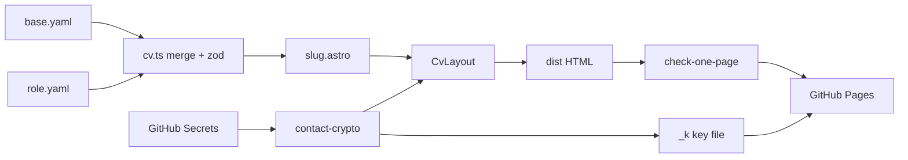

# Requirements

### Overview & Goals
Ein öffentliches GitHub-Repo `cv`, das mehrere englischsprachige, auf den kanadischen Markt zugeschnittene Lebensläufe als statische HTML-Seiten über GitHub Pages ausliefert. Jeder Lebenslauf passt auf genau **eine Druckseite (US Letter)** und lässt sich direkt aus dem Browser als schöne PDF drucken. Alle Lebensläufe nutzen **ein gemeinsames Layout**; Inhalte kommen aus YAML-Konfigurationsdateien.

| Rolle | URL |
|---|---|
| Web Developer | `https://heiko-h.github.io/cv/dev` |
| Project Manager | `https://heiko-h.github.io/cv/pm` |
| Business Analyst | `https://heiko-h.github.io/cv/ba` |
| Product Owner | `https://heiko-h.github.io/cv/po` |
| Technical Team Lead | `https://heiko-h.github.io/cv/lead` |

### Scope
**In Scope**
- Astro + TypeScript Projekt, ein Layout-Template, Konfiguration via `base.yaml` + Rollen-Overrides.
- Neuer Lebenslauf = neue YAML-Datei (optional `extends: <rolle>` für stellenspezifische Varianten, z. B. `dev-shopify.yaml` → `/cv/dev-shopify`).
- Screen- und Print-CSS (one page, Letter).
- Verschlüsselte Kontaktdaten (E-Mail, Telefon, Wohnort), Entschlüsselung nur nach menschlichem Klick.
- GitHub Actions: Build, One-Page-Check, Deploy bei jedem Push auf `main`.
- Inhalte für 5 Rollen, abgeleitet aus `CV-Resume.pdf`, durch Karriere-Coach-Perspektive optimiert.

**Out of Scope**
- Navigation, Website-Header/-Footer, Startseite mit Links (Root `/cv/` bleibt leer/noindex).
- Serverseitige Generierung von PDF-Dateien (PDF entsteht per Browser-Druck).
- Mehrsprachigkeit (nur Englisch).

### User Stories
- Als **Recruiter** möchte ich den Lebenslauf schnell erfassen und als saubere einseitige PDF drucken können.
- Als **Recruiter** möchte ich per Klick die Kontaktdaten sehen und direkt mailen/anrufen können.
- Als **Heiko** möchte ich für eine neue Bewerbung nur eine YAML-Datei anlegen und pushen, damit nach dem Deploy eine neue URL verfügbar ist.
- Als **Heiko** möchte ich, dass meine Kontaktdaten weder im Repo noch im HTML-Quelltext im Klartext auftauchen.

### Functional Requirements
**Inhalte pro Lebenslauf**
- Header: Name, Rollentitel (z. B. *Business Analyst*), Kontaktblock (verschlüsselt), optional LinkedIn/GitHub.
- Professional Summary (3–4 Sätze, rollenspezifisch).
- Skills: ~5 Kategorien × max. 5 Punkte (Schema validiert Maximum).
- Certifications: 3 Einträge (Name, Aussteller, Datum, optional Link).
- Education.
- Work History: Firma, Titel, Ort, Zeitraum, optional Unterpositionen (Travix: Web Developer → Team Lead & PM), rollenspezifische Bullets.

**Kontaktdaten-Schutz**
- Klartext nur in GitHub Secrets (`CV_EMAIL`, `CV_PHONE`, `CV_LOCATION`) bzw. lokal in gitignorter `.env`.
- Im HTML nur AES-256-GCM-Ciphertext; Schlüssel liegt **nicht** im HTML.
- Anzeige initial: Button „Show contact details“. Entschlüsselung nur bei echtem Nutzerklick (Heuristiken siehe Technical Design).
- Nach Entschlüsselung: `mailto:`/`tel:`-Links.
- Druck ohne vorherigen Klick: Hinweis *„Contact details: see web version“* + URL; nach Klick werden echte Daten gedruckt.
- Name bleibt sichtbar (Überschrift/Seitentitel – Recruiter braucht ihn).

**Layout & Design (kanadischer Markt)**
- Kein Foto, kein Geburtsdatum, kein Familienstand.
- Ruhig, schlicht: Weiß, Anthrazit-Text (`#1f2933`), eine Akzentfarbe (Navy `#1e3a5f`) für Name, Section-Headings und feine Linien.
- Schrift: *Inter* (self-hosted via `@fontsource`), Fließtext ~9.5–10 pt im Druck, klare Hierarchie.
- Zweispaltig: schmale linke Spalte (Skills, Certifications, Education, Languages), breite rechte Spalte (Summary, Work History) – analog zum Beispiel-PDF.
- Mobile: einspaltig.

### Non-Functional Requirements
- Einfacher Stack, keine Laufzeit-Frameworks im Client (nur ein kleines TS-Script für Kontakte).
- Kein redundanter Code/Inhalt (Base + Overrides).
- Build schlägt fehl, wenn ein Lebenslauf > 1 Druckseite ergibt oder Schema-Fehler hat.
- `noindex` per Default (konfigurierbar in `base.yaml`).

# Technical Design

### Key Decisions
- **Astro (static output) + TypeScript**: ideal für statische Seiten aus Daten, `getStaticPaths` erzeugt pro YAML eine Route, null JS per Default. Einfacher als Next/11ty-Setups mit TS.
- **Base + Overrides**: `base.yaml` enthält gemeinsame Daten; Rollen-Dateien überschreiben Summary, Skills, Job-Bullets. Merge-Regeln: Objekte deep-merge, Arrays ersetzen; Jobs werden per `id` adressiert. `extends` erlaubt Ketten (`dev-shopify` → `dev` → `base`).
- **Zod-Schema** validiert die gemergte Konfiguration (inkl. max. 5 Skills/Kategorie) beim Build.
- **Kontakt-Verschlüsselung**: GitHub Secrets (werden in Logs maskiert, nie angezeigt) → beim Build AES-256-GCM mit pro Build zufälligem Schlüssel. Ciphertext im HTML, Schlüssel in separater Datei mit zufälligem Namen, die erst nach verifiziertem Klick geladen wird. Hinweis: Jede rein clientseitige Lösung ohne Passwort ist letztlich vom Browser entschlüsselbar – Ziel ist, Scraper/LLM-Crawler, die HTML lesen oder blind klicken, zuverlässig auszuschließen.
- **Papierformat US Letter** (Kanada-Standard), `@page { size: letter; margin: 0.45in }`.
- **One-Page-Garantie** per Playwright-Script im CI (PDF rendern, Seitenzahl prüfen).

### Proposed Changes
**Config-Loader** (`src/lib/cv.ts`): liest `src/content/cvs/*.yaml` (außer `base.yaml`), löst `extends` rekursiv auf, merged, validiert mit Zod, liefert `{ slug, data }[]`. `src/pages/[slug].astro` nutzt das in `getStaticPaths`.

**Encryption** (`src/lib/contact-crypto.ts`, Build-Zeit, Node `crypto`):
1. Liest `CV_EMAIL`, `CV_PHONE`, `CV_LOCATION` aus `process.env` (Fallback-Platzhalter + Warnung lokal; im CI fehlend → Build-Fehler).
2. Zufälliger 256-bit Key + 96-bit IV; verschlüsselt JSON-Payload; Ergebnis als `data-c` Attribut.
3. Key wird XOR-maskiert und als `public/`-unabhängiges Build-Asset `dist/_k/<random-hex>.bin` geschrieben (via kleine Astro-Integration im `astro:build:done` Hook); Dateiname wird nur im Script-Bundle referenziert. `robots.txt` disallow `/cv/_k/`.

**Reveal-Script** (`src/scripts/contact.ts`, client):
- Klick-Handler akzeptiert nur, wenn: `event.isTrusted`, `navigator.webdriver !== true`, vorherige echte Pointer-/Touch-/Keyboard-Interaktion, ≥1,5 s seit Page-Load, Klickposition innerhalb des Buttons.
- Dann `fetch` Key → unmask → `crypto.subtle.decrypt('AES-GCM')` → DOM-Elemente (`mailto:`, `tel:`) per `textContent` einsetzen.
- Button ist ein echtes `<button>` ohne `href` → Link-Crawler folgen nichts.

**Layout** (`src/layouts/CvLayout.astro` + Komponenten) und **CSS** (`src/styles/cv.css` mit CSS-Variablen, `@media print`): Print blendet Button aus, zeigt Fallback-Hinweis wenn nicht entschlüsselt, `print-color-adjust: exact`, `break-inside: avoid` für Jobs.

**Astro-Config**: `site: 'https://heiko-h.github.io'`, `base: '/cv'`, `trailingSlash: 'ignore'`, `output: 'static'`.

### Data Models / Contracts
```ts
const Skill = z.object({ category: z.string(), items: z.array(z.string()).max(5) });
const Cert = z.object({ name: z.string(), issuer: z.string(), date: z.string(), url: z.string().url().optional() });
const Position = z.object({ title: z.string(), period: z.string().optional(), bullets: z.array(z.string()) });
const Job = z.object({ id: z.string(), company: z.string(), title: z.string(), location: z.string(),
  start: z.string(), end: z.string(), bullets: z.array(z.string()).default([]),
  positions: z.array(Position).optional(), hidden: z.boolean().default(false) });
export const CvSchema = z.object({
  name: z.string(), headline: z.string(), summary: z.string(),
  links: z.array(z.object({ label: z.string(), url: z.string() })).default([]),
  skills: z.array(Skill).max(6), certifications: z.array(Cert).max(3),
  education: z.array(z.object({ school: z.string(), location: z.string(), date: z.string(), degree: z.string() })),
  languages: z.array(z.object({ name: z.string(), level: z.string() })),
  work: z.array(Job), seo: z.object({ index: z.boolean().default(false) }).default({}),
});
```
Rollen-Override (Beispiel `ba.yaml`):
```yaml
headline: Business Analyst
summary: >-
  Business Analyst with 14+ years ...
skills: [...]          # ersetzt komplett
work:                  # per id gemerged
  travix: { bullets: [...] }
  html-design: { hidden: false }
```

### File Structure
```
cv/
├─ .github/workflows/deploy.yml
├─ .env.example                 # CV_EMAIL, CV_PHONE, CV_LOCATION
├─ astro.config.mjs
├─ package.json / tsconfig.json
├─ integrations/contact-key.ts  # schreibt dist/_k/<hash>.bin
├─ scripts/check-one-page.ts    # Playwright PDF page count
├─ public/robots.txt
├─ src/
│  ├─ content/cvs/ base.yaml dev.yaml pm.yaml ba.yaml po.yaml lead.yaml
│  ├─ lib/ schema.ts cv.ts merge.ts contact-crypto.ts
│  ├─ layouts/CvLayout.astro
│  ├─ components/ Header.astro Contact.astro Section.astro Skills.astro WorkItem.astro
│  ├─ scripts/contact.ts
│  ├─ styles/cv.css
│  └─ pages/ [slug].astro index.astro (leer, noindex)
└─ README.md                    # neue Bewerbung anlegen, Secrets setzen
```

### Architecture Diagram


### Risks
- **Inhalt > 1 Seite**: CI-Check bricht ab; Lösung: Bullets kürzen oder Override `hidden`. Typografie-Variablen (`--fs-base`) erlauben Feintuning.
- **Secrets fehlen** im Fork/lokal → Platzhalter lokal, harter Fehler im CI.
- **Absolute Sicherheit unmöglich** ohne Passwort; Schutz zielt auf automatisierte Erfassung.
- Hinweis: Zertifikat IREB im PDF mit Datum *08/2026* (Zukunft) – wird beim Content-Schritt geprüft/als 08/2025 o. Ä. markiert.

# Content Strategy

### Kanadische Resume-Konventionen
- Kein Foto, keine persönlichen Daten außer Kontakt; Ort als *„Stuttgart, Germany – relocating to Canada“* (bzw. Wert aus Secret).
- Kanadisches Englisch (*analyse → analyze* nur wenn US/CA-üblich; „organization“, „centre“ wahlweise) – einheitlich **Canadian English**.
- Bullets: Action Verb + Ergebnis + Zahl (z. B. „reducing processing time from 4–5 s to <1 s“).
- Max. 3–4 Bullets pro Station, ältere Station (HTML Design) gekürzt.
- Keywords je Rolle für ATS.

### Rollen-Fokus
| Rolle | Headline | Summary-Fokus | Skill-Kategorien (Bsp.) |
|---|---|---|---|
| dev | Full-Stack Web Developer | PHP/Symfony, TS, React/Vue, Integrationen, Pimcore | Languages & Frameworks, Frontend, Backend & Data, Platforms (Pimcore/TYPO3), Tools (Docker, Git, CI) |
| pm | IT Project Manager | 12+ Projekte, 11+ Kunden, Budget/Scope, Stakeholder | Delivery, Planning & Budget, Stakeholders, Methods (Agile/Scrum), Technical Background |
| ba | Business Analyst | Requirements, Prozessanalyse, CPRE (aus PDF) | Business & Requirements, Systems & Technology, Delivery & Stakeholders, Technical, Languages |
| po | Product Owner | Backlog, Priorisierung, Nutzer-Probleme, Value | Product, Requirements, Stakeholders, Delivery, Technical |
| lead | Technical Team Lead | Teams bis 9 Devs, Mentoring 5, Code Quality, Architektur | Leadership, Engineering Practices, Architecture, Tech Stack, Delivery |

Gemeinsam in `base.yaml`: Name, Education (HdM Stuttgart, B.Sc. Business Informatics, 03/2012), Certifications (IREB CPRE FL, Pimcore Consultant, Pimcore Enterprise Developer), Languages (German native, English fluent, French/Italian basic), Job-Stammdaten aller drei Stationen mit neutralen Default-Bullets.

# Testing

### Validation Approach
- `npm run build` mit Test-Env-Variablen → alle 5 Routen werden erzeugt, Zod validiert.
- `npm run check:pages` (Playwright Chromium, `page.pdf({ format: 'Letter' })`) → jede Seite exakt 1 Seite.
- Grep auf `dist/` nach Test-E-Mail/-Telefon im Klartext → **keine Treffer**.

### Key Scenarios
- `/cv/dev`, `/cv/pm`, `/cv/ba`, `/cv/po`, `/cv/lead` laden mit korrektem `base`-Pfad (Fonts/CSS/JS).
- Echter Klick (Playwright mit Mausbewegung, Wartezeit) → Kontaktdaten erscheinen als `mailto:`/`tel:`.
- Neue Datei `dev-test.yaml` mit `extends: dev` → `/cv/dev-test` entsteht ohne Code-Änderung.

### Edge Cases
- Programmatischer `element.click()` / sofortiger Klick ohne Interaktion → keine Entschlüsselung.
- Druck ohne Klick → Fallback-Hinweis statt Kontaktdaten, kein Button im PDF.
- Skill-Kategorie mit 6 Punkten → Build-Fehler mit klarer Meldung.
- Fehlende Secrets im CI → Build-Fehler.

### Test Changes
- Unit-Tests (Vitest) für `merge.ts` (deep-merge, Array-Replace, Job-by-id, `extends`-Kette, Zyklus-Erkennung) und Round-Trip Encrypt/Decrypt.

# Delivery Steps

### ✓ Step 1: Scaffold Astro project with config loader and schema
An Astro + TypeScript project builds one static route per CV YAML under `/cv/<slug>`.

- Create `package.json`, `astro.config.mjs` (`site`, `base: '/cv'`, static), `tsconfig.json`, `.gitignore`, `.env.example`.
- Add `src/lib/schema.ts` (Zod `CvSchema`), `src/lib/merge.ts` (deep-merge, array replace, jobs by `id`, `extends` chain with cycle detection), `src/lib/cv.ts` (load + merge + validate).
- Add `src/pages/[slug].astro` using `getStaticPaths`, empty noindex `index.astro`, `public/robots.txt`.
- Vitest unit tests for merge/extends logic.

### ✓ Step 2: Build CV layout template with screen and print CSS
A single reusable layout renders any CV config as a clean two-column page that prints on exactly one US Letter page.

- `src/layouts/CvLayout.astro` and components `Header`, `Section`, `Skills`, `WorkItem` (incl. sub-positions).
- `src/styles/cv.css`: CSS variables (navy accent, anthracite text), self-hosted Inter via `@fontsource/inter`, responsive single column on mobile.
- `@media print` + `@page { size: letter }`: tuned font sizes/margins, `print-color-adjust: exact`, `break-inside: avoid`, hide interactive elements.
- Meta tags: title `Name – Headline`, `noindex` driven by `seo.index`.

### ✓ Step 3: Implement encrypted contact details with human-only reveal
Email, phone and location never appear in plaintext in repo or HTML and are revealed only after a genuine user click.

- `src/lib/contact-crypto.ts`: read `CV_EMAIL`/`CV_PHONE`/`CV_LOCATION`, AES-256-GCM encrypt with random per-build key; fail in CI if missing, placeholders locally.
- `integrations/contact-key.ts`: write masked key to `dist/_k/<random>.bin`; disallow in `robots.txt`.
- `Contact.astro` with `<button>` + `data-c` ciphertext; `src/scripts/contact.ts` with `isTrusted`, webdriver, prior-interaction and dwell-time checks, then fetch key and WebCrypto decrypt into `mailto:`/`tel:` links.
- Print fallback text when not revealed.
- Round-trip encrypt/decrypt unit test and dist plaintext grep check.

### ✓ Step 4: Write tailored content for the five roles
`base.yaml` plus `dev`, `pm`, `ba`, `po`, `lead` overrides contain polished Canadian-market resume content.

- `base.yaml`: name, education, 3 certifications, languages, all jobs with ids and default bullets from `CV-Resume.pdf`.
- Per role: headline, summary, ~5 skill categories (≤5 items), role-specific job bullets with action verbs and metrics.
- Canadian English, ATS keywords per role, no photo/personal data.
- Verify every role renders on one page; trim bullets where needed.

### ✓ Step 5: Add one-page check, GitHub Actions deployment and README
Every push to `main` builds, verifies and deploys all CVs to GitHub Pages.

- `scripts/check-one-page.ts` (Playwright Chromium, Letter PDF page count = 1 per route) as `npm run check:pages`.
- `.github/workflows/deploy.yml`: checkout, setup-node, `npm ci`, test, build with secrets as env, Playwright check, `upload-pages-artifact`, `deploy-pages`; triggers on push and `workflow_dispatch`.
- `README.md`: setting GitHub Secrets, enabling Pages (source: GitHub Actions), creating a new CV via YAML with `extends`, local dev with `.env`.